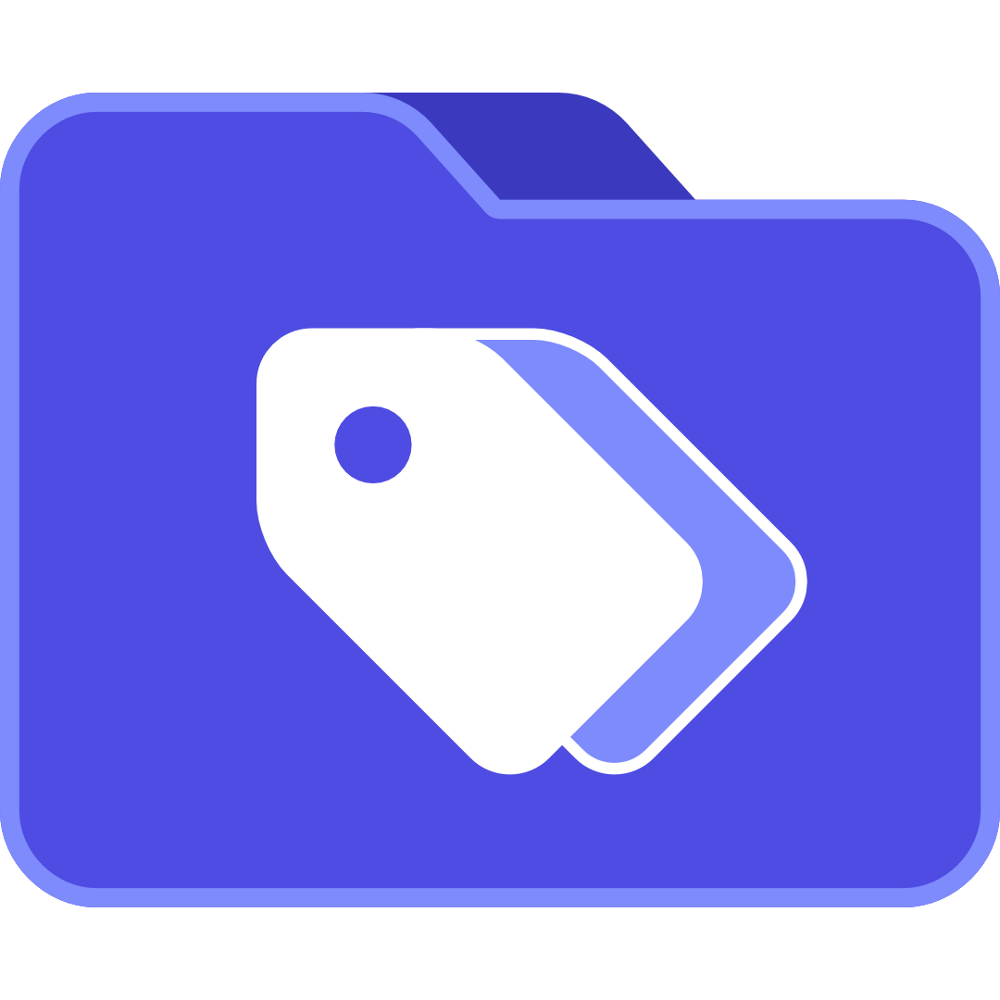

  
  
  <h1>TagThemAll</h1>
  
  <h3>Tagger de fichiers & fuzzy finder rapide, natif et ultra-léger pour Windows.</h3>
  
  

    Organisez et retrouvez instantanément n'importe quel fichier sur vos disques sans jamais copier, déplacer ni modifier vos fichiers d'origine (architecture par référence inspirée de <strong>DaVinci Resolve</strong> et <strong>Adobe Lightroom</strong>).
  

   

  

    
    
    
    
    
    
  

  
  

    🇬🇧 <em><a href="README.md">English version available here</a></em>
  

> [!NOTE]
> ### ☕ Un petit mot de l'auteur
> **Pour être tout à fait transparent :** Je ne suis pas développeur, et l'écosystème GitHub / open source est un univers totalement nouveau pour moi !
> 
> J'ai simplement **vibe codé** TagThemAll par pur besoin personnel, parce qu'aucune solution existante ne me convenait au quotidien.
> 
> Si vous ouvrez des Issues ou des Pull Requests, **soyez indulgents et laissez-moi un peu de temps** pour les traiter : le dev n'est pas du tout mon métier. Merci infiniment pour votre bienveillance et votre compréhension ! ❤️

---

## ⚡ Caractéristiques Principales

* **100% Natif Windows & Zéro Techno Web** :
  * Développé en **C# / .NET 9 + WPF Moderne (Fluent / Dark UI)**.
  * Zéro Electron, zéro Chromium, aucun serveur externe, aucun accès réseau requis.
  * Démarrage instantané, empreinte mémoire minimale, accélération matérielle DirectX.
* **Import Non-Destructif par Glisser-Déposer (Drag & Drop)** :
  * Glissez-déposez un ou plusieurs fichiers, ou même des dossiers entiers.
  * L'application conserve uniquement le **chemin absolu** et les métadonnées (nom, extension, taille, date). Aucun fichier n'est copié, déplacé ou altéré.
* **Moteur de Vignettes Hautes Performances (Windows Shell Natif)** :
  * Utilise directement l'API COM native de Windows `IShellItemImageFactory`.
  * Si Windows a déjà calculé la vignette (dans son cache Explorer), elle est affichée immédiatement.
  * Si la vignette n'est pas encore disponible, elle est extraite en tâche de fond de manière asynchrone sans jamais figer l'interface.
  * Fallback automatique sur les icônes vectorielles / Shell haute résolution pour les fichiers sans miniatures (code, documents textes, etc.).
* **Gestion UNLINKED & RELINK (Style DaVinci Resolve)** :
  * Si un fichier est déplacé, renommé ou supprimé en dehors de l'application, sa vignette est immédiatement recouverte d'un badge rouge **`UNLINKED`**.
  * Filtre en 1 clic pour isoler les fichiers `UNLINKED`.
  * Fonction **Relink** : faites un clic droit ou cliquez sur **Relier (Relink)** et sélectionnez simplement le dossier où se trouvent désormais vos fichiers : l'application scanne le dossier, résout automatiquement les correspondances et rétablit les liens sans perdre aucun tag !
* **Aperçu Instantané QuickLook (Style macOS)** :
  * Appuyez sur <kbd>Espace</kbd> (ou double-cliquez) sur n'importe quel fichier pour ouvrir une fenêtre de prévisualisation haute résolution instantanée.
  * Prévisualisez images plein écran, vidéos, fichiers audio, textes et code source avec leurs dimensions et métadonnées.
  * Naviguez de fichier en fichier avec les flèches du clavier sans fermer l'aperçu.
* **Glisser-Déposer Sortant (Workflow Créatif Sans Friction)** :
  * Glissez-déposez n'importe quel fichier directement **depuis TagThemAll vers vos logiciels externes** : Premiere Pro, DaVinci Resolve, Photoshop, Blender, Discord, Slack ou l'Explorateur Windows.
  * Plus besoin de fouiller dans vos dossiers : retrouvez votre fichier par tag, saisissez-le et déposez-le directement sur votre timeline ou canevas de montage !
* **Système de Tags Instantané & Fuzzy Search** :
  * Multi-sélection de fichiers (Ctrl + Clic, Shift + Clic, Ctrl + A).
  * Saisie rapide : tapez `nuit` + <kbd>Entrée</kbd> pour créer et appliquer le tag immédiatement.
  * Autocomplétion dynamique (ex: tapez `nu` pour voir les tags existants correspondants et les sélectionner).
  * Badges de couleur générés automatiquement de façon harmonieuse.
  * Suppression d'un tag en un clic sur sa croix `×`.
* **Barre de Recherche Centrale & Filtres** :
  * Recherche fuzzy temps réel par Tags (par défaut), par Nom de fichier ou les deux.
  * Filtres rapides : `Tous`, `UNLINKED`, `Sans tag (UNTAGGED)`, `Images`, `Vidéos`, `Audio`, `Documents`.
  * Tris multiples : Nom, Date de modification, Date d'ajout, Taille, Nombre de tags (Ordre Ascendant / Descendant).
  * Bascule vue **Grille de vignettes** (avec zoom réglable) vs vue **Liste détaillée**.

---

## 📦 Téléchargement & Exécution

Deux formats prêts à l'emploi sont générés dans le dossier `publish/` :

1. **Installeur Windows standard** :
   * Fichier : `publish\Installer\TagThemAll-Setup.exe`
   * Double-cliquez pour installer TagThemAll sur votre PC avec raccourci sur le Bureau et dans le Menu Démarrer.
2. **Version Portable (Sans installation)** :
   * Fichier : `publish\TagThemAll-Portable\TagThemAll.exe`
   * Fichier `.exe` unique autonome à exécuter directement (même depuis une clé USB).

---

## ⌨️ Raccourcis Clavier

| Raccourci | Action |
|---|---|
| <kbd>Espace</kbd> | Ouvrir / fermer la prévisualisation instantanée QuickLook sur le fichier sélectionné |
| <kbd>←</kbd> / <kbd>→</kbd> (dans QuickLook) | Passer au fichier précédent / suivant dans l'aperçu |
| <kbd>Ctrl</kbd> + <kbd>A</kbd> | Tout sélectionner dans la vue actuelle |
| <kbd>Échap</kbd> | Tout désélectionner / fermer les suggestions de tags |
| <kbd>Entrée</kbd> (dans le champ tag) | Valider et appliquer le tag à la sélection |
| <kbd>Flèche Bas</kbd> (dans le champ tag) | Naviguer dans les suggestions de tags |
| <kbd>Suppr</kbd> | Retirer les fichiers sélectionnés du catalogue de l'application |
| <kbd>F5</kbd> | Rafraîchir les vignettes |

---

## 💾 Stockage des Données

* Base de données : **SQLite** locale intégrée, optimisée en mode WAL.
* Emplacement par défaut : `%LocalAppData%\TagThemAll\tagthemall.db`
* Mode portable : si un fichier `portable.txt` est placé à côté de l'exécutable, la base de données `tagthemall.db` est automatiquement stockée dans le même dossier que l'application.

---

## 📄 Licence

Ce projet est distribué sous licence libre et protectrice [GNU General Public License v3.0 (GPLv3)](LICENSE).
